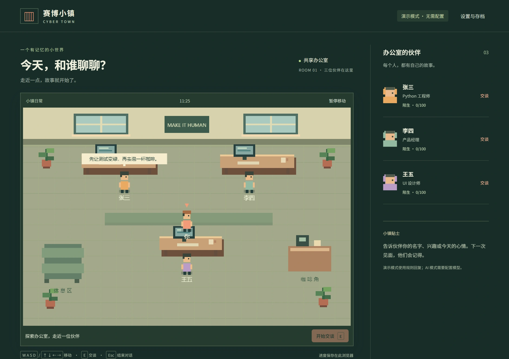
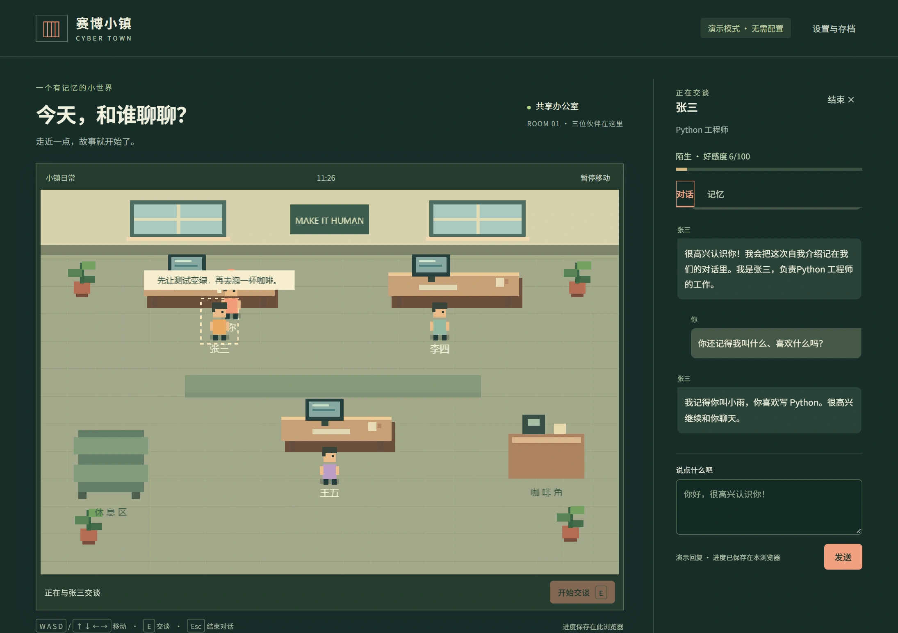
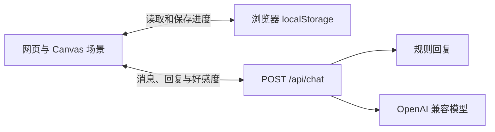

# 赛博小镇 · Cyber Town

一个可以直接在浏览器里游玩的像素办公室。走到同事身边，聊聊代码、产品或设计，让他们慢慢记住你。

无需安装游戏客户端。页面右上角会显示当前使用的是规则演示还是 AI 对话。[在线体验](https://cyber-town.vercel.app/)

## 游戏截图



在共享办公室里可以遇到 Python 工程师张三、产品经理李四和 UI 设计师王五。电脑上用 `WASD` 或方向键移动，走近居民后按 `E` 交谈，按 `Esc` 结束。手机上使用画面下方的方向按钮和「开始交谈」。



想试试角色记忆，可以对张三说「我叫小雨，我喜欢写 Python。」刷新页面后，再问他「你还记得我叫什么、喜欢什么吗？」右侧的「记忆」标签能查看这位居民记下的消息，「小镇动态」会显示每次对话的好感度变化。截图来自本地演示模式。

## 本地运行

需要 Node.js 22.x 和 npm。在仓库目录运行以下命令。

```bash
npm install
npm run dev:full
```

打开 `http://127.0.0.1:5173`。`dev:full` 在同一地址提供网页和 API。全新检出可以直接用演示模式，无需申请模型密钥。

```bash
npm test         # 自动测试
npm run build   # 生产构建
npm run dev     # 只启动网页开发服务
```

## 技术实现

Vite 构建静态页面，原生 JavaScript 管理键盘、触控和对话界面。办公室、人物和背景气泡由 Canvas 2D 逐帧绘制，场景代码也负责家具碰撞和交谈距离。生产环境由 Vercel 托管静态页面，网页通过同一域名调用 Node.js Functions。[场景代码](src/world.js) · [交互代码](src/main.js)



### NPC 怎么记住你

1. **组织对话上下文。** 浏览器只发送当前居民的最近 10 条对话消息和最多 5 条长期记忆。记忆按与新消息共有的相邻双字符片段数排名，匹配数相同就优先选较新的记录。服务端再次筛选，并只将过去 120 分钟内的对话消息用于本轮回复。[检索代码](lib/world.js)
2. **生成回复和好感度变化。** 演示模式按关键词和角色规则回应。AI 模式将角色设定、当前关系、近期对话和选出的记忆交给模型，再检查返回格式。好感度限制在 0–100 分，界面会显示分数和关系等级。[对话接口](api/chat.js)
3. **写入浏览器存档。** 收到成功回复后，网页把本轮对话、新的好感度和互动日志保存到 `localStorage`，并把玩家这条消息存为一条长期记忆。每位居民分别保留最近 50 条对话消息和 200 条记忆。进度保存在当前浏览器的当前站点下，换设备可通过「设置与存档」手动导出和导入 JSON。[存档代码](src/storage.js)

### 服务端接口

| 接口 | 用途 |
| --- | --- |
| `GET /api/status` | 页面打开时读取当前模式（`demo` 或 `ai`）。 |
| `POST /api/chat` | 接收居民 ID、消息、近期对话、选出的记忆和当前好感度，返回回复、分数变化和新增记忆。 |
| `POST /api/ambient` | 一次获取三位居民的背景气泡台词。 |

## 部署与模型配置

在 Vercel 导入仓库，使用 `npm run build` 构建，输出目录为 `dist`。未设置 `LLM_API_KEY` 时运行规则演示。启用 AI 对话时，在服务端设置 `LLM_API_KEY`、`LLM_BASE_URL` 和 `LLM_MODEL`，其中模型地址须使用 HTTPS。本地可以用 `.env.example` 作为模板创建 `.env`，部署时则在 Vercel 设置环境变量。[环境变量示例](.env.example) · [部署步骤](docs/deployment.md)

## 项目文档

| 文档                             | 内容                            |
| -------------------------------- | ------------------------------- |
| [需求文档](docs/requirements.md) | 功能范围、约束与验收标准        |
| [架构文档](docs/architecture.md) | 模块职责、数据流、接口及取舍    |
| [验收清单](docs/acceptance.md)   | 分阶段交付与可重复验证步骤      |
| [部署与配置](docs/deployment.md) | Vercel 发布、模型接入与故障排查 |
