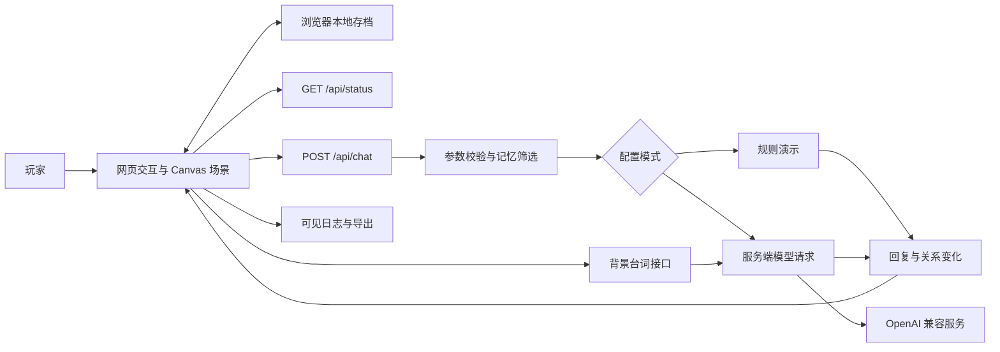

# 赛博小镇架构设计

## 1. 设计选择

Vite 构建网页静态资源，Canvas 绘制办公室，原生 JavaScript 管理交互，Vercel Node.js Functions 处理模型调用。这样无需安装游戏客户端或维护常驻进程。

长期状态保存在浏览器，不能放在函数进程变量中：无服务器函数可能随请求创建、复用或销毁，进程内存不是可靠存档。

## 2. 数据流



| 模块             | 职责                                         |
| ---------------- | -------------------------------------------- |
| 场景渲染         | 地图、像素人物、背景台词、接近提示与位置     |
| 交互控制         | 键盘/触屏、碰撞、NPC 选择、对话表单          |
| 浏览器状态       | 独立角色历史、记忆、关系和存档               |
| `lib/world.js`   | NPC 定义、关系等级与共享逻辑                 |
| `api/status.js`  | 返回模式与可公开的服务状态                   |
| `api/chat.js`    | 输入校验、上下文组织、模型请求、关系变化约束 |
| `api/ambient.js` | 批量生成背景台词                             |

## 3. 一次对话

1. 玩家输入消息，界面进入等待状态，阻止重复发送。
2. 浏览器将当前角色的历史、记忆和关系发送到同源接口。
3. 服务端校验 NPC、消息长度、类型及可选访问口令。
4. 筛选最近 10 条且未超过 120 分钟的消息，以及至多 5 条相关长期记忆。
5. 将固定角色设定、关系说明与用户上下文分别组织，进入演示或模型处理。
6. 校验返回值并限制关系变化，返回回复及新增记忆。
7. 浏览器只在成功后更新历史、关系、存档与日志；失败则显示错误并恢复输入。

用户历史和记忆属于不可信数据，不能作为高优先级系统指令。模型内容也不能直接作为 HTML 执行。

## 4. API 协议

接口使用 JSON；失败返回非成功状态码及可读错误。接口不得返回密钥。

### GET `/api/status`

返回 `demo` 或 `ai` 模式。页面以服务端状态为准，不通过前端环境变量猜测模式。

### POST `/api/chat`

```json
{
  "npcId": "engineer",
  "message": "你好，我喜欢写 Python。",
  "history": [{ "role": "user", "content": "你好", "at": 1795075200000 }],
  "memories": [{ "text": "玩家喜欢写 Python", "at": 1795075200000 }],
  "affinity": 20
}
```

```json
{
  "reply": "你好，我们可以聊聊你最近写的程序。",
  "affinity": 23,
  "delta": 3,
  "reason": "友好的交流",
  "level": "熟悉",
  "memory": { "text": "玩家喜欢写 Python", "at": 1795075200000 },
  "mode": "demo"
}
```

示例说明结构，不保证回复逐字相同。`at` 是毫秒时间戳，`npcId` 必须为已知角色。配置访问口令时使用 `x-access-key` 请求头，不放入 URL。

### `/api/ambient`

批量生成办公室内全部角色的背景台词，减少独立调用次数。前端复用结果并控制刷新频率；该接口不修改玩家记忆或关系。

## 5. 状态与存档

- 短期上下文按时间和数量双重限制。
- 每个角色保留最多 200 条长期记忆；使用文本相关度，不承诺向量语义检索。
- 存档属于当前浏览器与站点域名。更换设备、清除数据或隐私模式可能导致进度不可用。
- 存档读取需要校验，损坏时安全恢复；存储不可用时应允许当前会话游玩并提示无法保存。
- 好感度来自浏览器，服务端限制范围；适用于单人体验，不能用于防作弊或权限系统。

## 6. 模型与安全

服务端读取 `LLM_API_KEY`、`LLM_BASE_URL`、`LLM_MODEL`；禁止使用会打包到网页的 `VITE_` 前缀。基础地址由部署者配置，不允许聊天请求任意指定上游地址。

模型请求需要超时、输入上限和输出校验。`APP_ACCESS_KEY` 可为私人体验提供共享口令，但不等同于账户系统或分布式限流。公开 AI 模式建议配置口令及供应商消费限额；不能声称进程内计数可以限制整个无服务器站点的消费。

## 7. 日志与验证

浏览器提供可见互动日志与主动导出。服务端仅记录请求结果等必要元信息，Vercel 函数日志不充当永久聊天数据库。

本地使用网页及 API 服务，生产同源部署，减少跨域配置。自动测试覆盖关系边界、记忆隔离和接口异常；浏览器验收覆盖移动、中文输入、存档恢复与手机布局。
